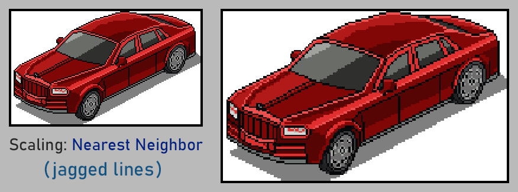

# Pixels150

**Pixels150** is a command-line tool that takes a PNG image and scales it to 1.5x, or 150% of its original size. The scaling process it uses is especially adapted to pixel art.

## What is the use of this?

This tool is useful for 2 reasons. First, upscaling to 150% lets you adapt pixel art from classic systems (PC, consoles, arcades...). Many of these used resolutions like 320x240, and using 150% is a perfect fit to adapt those assets to 16:9 resolutions like 640x360. This resolution is used in several retro-style indie games and in fantasy consoles like Vircon32.

Second, it turns out that none the usual scaling methods work well in this case:
- Pixel art scalers, like Eagle or Scale2X, normally only accept integer scales.
- For nearest-neighbor, the result is very jagged at 150%.
- Interpolation, like bilinear or bicubic, makes a blurry mess.





## How does it work?
It first applies a 3X upscale using algorithm xBR (scale by rules) with no color blending. Then it reduces the result by half using nearest-neighbor.

The xBR algorithm is based on the work of **Hyllian (Jararaca)** and the implementation from **Treeki's [libxbr-standalone](https://github.com/Treeki/libxbr-standalone)** (itself adapted from FFmpeg's xBR filter).

## How to use it
Pixels150 is a command-line tool. You can use it with a simple command like this:

```sh
pixels150 input.png output.png
```

The tool will allow input and output paths to be the same, overwriting the source. Note that only **PNG** format is supported for both input and output. The use of transparency or an alpha channel is supported.

## How to build from source code

This build uses **C++17** to compile, **CMake** as build system, and **libpng** to load/save PNG files. Note that libpng, in turn, requires **zlib**. The provided CMake script must be able to find libpng in your system. Once you have these installed, create a subfolder named `build` and from it follow one of these alternatives:

**Windows, with Visual Studio (example for VS 2022)**:

```bat
cmake -G "Visual Studio 17 2022" -A x64 ..
cmake --build . --config Release
```

**Windows, using MSYS2/MinGW**:

```sh
cmake -G "MSYS Makefiles" ..
cmake --build .
```

**Linux and Unix-like systems**:

```sh
cmake ..
cmake --build .
```

Once the build is successful you may use the executable directly from the build folder, or copy it to a path from where it can be run as a command.

## License
This program and its source code are offered under the **GPL 3.0 License**. See [License.md](License.md) for the full license text and credits.
